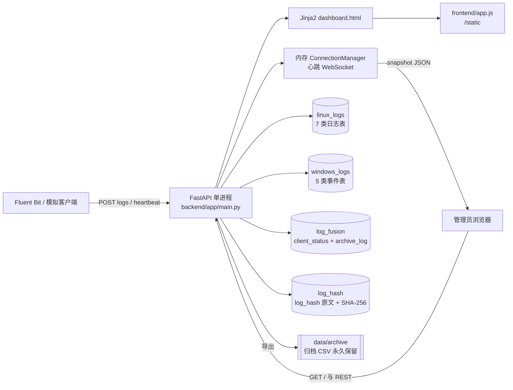
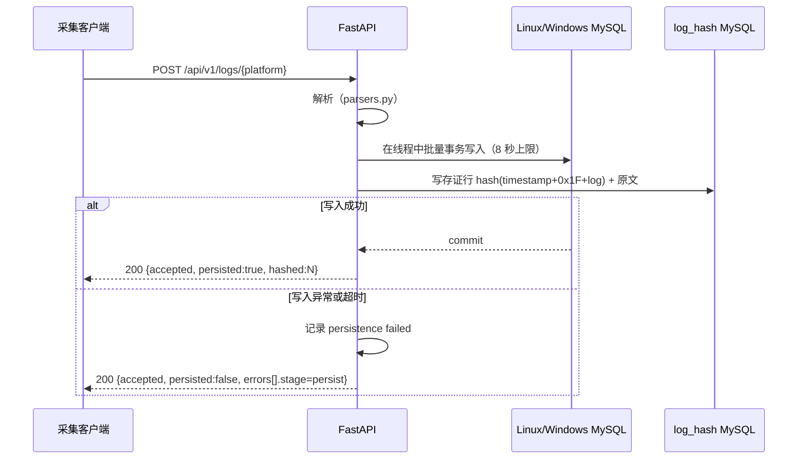
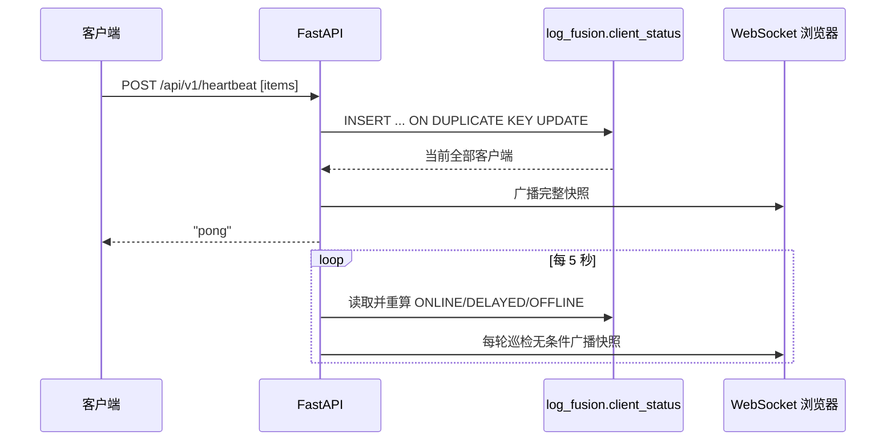

# 系统架构

> 基线日期：2026-10-10（同日按当前工作区代码复核）。架构描述来自当前 `backend/`、`frontend/` 和根启动脚本；旧 Spring Boot/Vue 工程仅作历史参考。

## 1. 架构概览

当前系统是单个 FastAPI 进程承载页面、API 与实时连接的四库应用。浏览器入口由 Jinja2 服务端渲染，页面再通过 HTTP（REST）与 WebSocket 获取动态数据（**SSE 已于 2026-10-13 移除**，见 ADR-015）。Linux、Windows 日志沿用不同的历史表结构，客户端状态写入独立平台库，原始日志存证写入独立的 `log_hash` 库。

## 2. 组件与职责

| 组件 | 职责 | 状态边界 |
|---|---|---|
| `backend/app/main.py` | FastAPI 应用、路由、静态资源禁缓存中间件、日志写入、原始日志存证写入、存证摘要（含按平台拆分与首次写入时间）/列表/导出、归档接口、服务端更新触发接口、心跳 upsert、WebSocket、生命周期巡检与每日自动归档任务 | 应用主入口 |
| `backend/app/security_logs.py` | 绿盟日志归一化、MySQL 身份去重/冲突检测、持久化补录/增量队列、会话锁、游标查询 | 后台默认开启，仅实时；显式历史 CLI 可续跑；DDL 与字段字典在 security-log-client/sql |
| `backend/app/device_log_catalog.py` | WAF/DAS 六表原生字段、类型、tag 路由与可审查 DDL | 不注册到 Base、不自动建表 |
| `backend/app/syslog_protocol.py` | RFC3164/RFC5424 消息头、RFC6587 TCP 分帧、设备时区 | 字节长度上限；不把 EOF 残帧当日志 |
| `backend/app/syslog_parsers.py` | WAF 15 类与 DAS 新旧格式解析，原文/原字节保留、类型校验 | 纯函数；未知类型隔离，不套前端截图字段 |
| `backend/app/syslog_store.py` | SQLite FULL 同步缓冲、隔离/检查点与六表参数化写入 | 原始报文先落盘；稳定 ingest_id 重放 |
| `backend/app/syslog_server.py` | TCP/UDP 监听、来源过滤、接收限额、重试、status/replay CLI | 默认随 FastAPI lifespan 启停；导入不监听，详见 SYSLOG.md |
| `backend/app/config.py` | 从环境和 `.env` 加载应用/数据库配置、归档策略与 WAF/DAS Syslog 端口/来源等配置 | `get_settings()` 进程内缓存 |
| `backend/app/db.py` | 创建四个同步 SQLAlchemy Engine、监控库 Session、健康检查 | 每进程各自连接池 |
| `backend/app/models.py` | 声明 `ClientStatus`、`LogHash`、`ArchiveLog` ORM 模型 | 覆盖平台心跳表、存证表与归档台账 |
| `backend/app/catalog.py` | Linux/Windows 类别、Linux 查询列与真实列、Windows 分类视图展示列 | 代码内静态元数据 |
| `backend/app/services.py` | 分类查询（列表上限 100 / 导出上限 10000 / `full` 取整行）、汇总、跨库最近日志合并 | 同步 SQL |
| `backend/app/metrics.py` | 图表聚合层：时间桶趋势与 TOP 排行（进程内 TTL 缓存）、分类日志的事件维度统计（Windows 按 `event_id`、Linux 按 `type`，最多 10 类）、心跳历史环形缓冲（watchdog 每 5 秒采样） | 进程内缓存/缓冲，单 worker，重启后心跳历史清零 |
| `backend/app/parsers.py` | 原始日志 → 数据库行的解析（Linux auditd/syslog、Windows winlog），时间与列类型归一化 | 纯函数，无状态 |
| `backend/app/hashing.py` | 原始日志存证：按 `sha256(时间戳 + 0x1F + 存证原文)` 计算摘要并构造 `log_hash` 行；Linux 原文取 `log` 字段，Windows 取整条记录的规范化 JSON | 纯函数，无状态 |
| `backend/app/archive.py` | 存证归档：按条件选 id、分批取行、写 CSV 并校验落盘、按 id 删除、写归档台账 | 删除不可逆；文件落盘确认后才删 |
| `backend/app/ws.py` | 维护浏览器 WebSocket 集合并广播快照 | 进程内，不跨 worker |
| `dashboard.html` | 服务端页面骨架与功能区（含「融合日志管理」下 5 个分类日志子菜单、分类日志页与原始详情弹窗） | 根路由渲染 |
| `frontend/app.js` | Alpine 页面状态、REST 调用、分类日志视图（分页/关键词/整行原始详情）、心跳 WebSocket 连接/重连/假死检测、概览环形图（实例复用 + 尺寸自适应 + 图例/图形分列）、CSV 客户端导出 | 浏览器内存；图表布局由 `tools/chart-layout-check.cjs` 自检 |
| `启动服务.ps1` | 校验解释器、配置 PYTHONPATH、尝试开放防火墙、启动 Uvicorn | 默认 8080 |
| `deploy/log-fusion.service` | systemd 单元：工作目录 `backend/`、`ExecStart=<venv>/python run.py`、`Restart=always` | 服务器部署用，见 `docs/DEPLOY.md` |
| `deploy/install-service.sh` | 把上面的单元安装到 `/etc/systemd/system/`，做前置校验、`enable`、`restart` 与 `/health` 自检 | 一次性且幂等；单元改了重跑即可（服务名一致性由测试锁定） |
| `deploy/update-log-fusion.sh` | 服务端一键更新：停服 → 备份未提交改动 → `git fetch` + `git reset --hard origin/main` → 按需装依赖 → 重启 → `/health` 自检 | 由 `/api/v1/admin/update` 经 `systemd-run` 以独立单元执行；运行期文件靠 `.gitignore` 保护（ADR-020） |
| `backend/simulator/...` | 读取外部样例并发送心跳及两类日志 | 开发联调工具 |
| `security-log-client/` | 独立安全产品 API 项目：`nsfocus_api.py` 认证与分页、`nsfocus_log_search.py` 单页预览、`analyze_samples.py` 离线分析、`probe_log_types.py` 逐类探测并保存样例；使用及接口文档在项目内 | 与 backend/ 同级；真实配置位于 config/，样例/历史记录位于 data/，分析位于 reports/，通过 backend/app/security_logs.py 接入应用和 log_fusion，真实配置/响应不提交 |

`frontend/index.html` 与 `frontend/styles.css` 当前未被根路由使用；`/static` 挂载使它们可被直接访问，但不是现行页面入口。

## 3. 启动与生命周期

1. Uvicorn 导入 `app.main:app`，模块级创建四个 SQLAlchemy Engine 和 WebSocket 管理器。
2. FastAPI lifespan 启动时先 `Base.metadata.create_all(monitor_engine)` 创建 `log_fusion.client_status`，再 `create_all(hash_engine, tables=[LogHash.__table__])` 创建 `log_hash.log_hash`。
3. 任一步建表失败都记录异常但继续启动（库本身必须预先存在）。
4. lifespan 创建 `_status_watchdog()` 后台任务，每 5 秒重算所有客户端状态：仅当状态变化时才提交数据库，但**每轮都无条件广播一次完整快照**（见 ADR-009）。
5. 服务停止时取消 watchdog。进程结束会清空 WebSocket 连接；`client_status` 数据保留在 MySQL。

根脚本默认以单 worker 启动。当前代码没有显式配置 worker 数，也没有跨进程共享的实时消息层。

## 4. 页面请求链路

### 4.1 首屏

1. 浏览器请求 `GET /`。
2. 后端调用 `summary()` 统计 12 张分类表；异常时首页上下文降级为全 0。
3. Jinja2 返回 `dashboard.html`。
4. 浏览器从 `/static/vendor/` 加载 Bootstrap、HTMX、Alpine.js 和 ECharts，从 `/static/app.js` 加载本地交互代码。
5. Alpine 初始化时按 URL hash 恢复页面（默认概览），请求日志汇总和类别，连接心跳 WebSocket（`/ws/client-monitor`）；WebSocket 断开时退化为每 5 秒轮询 REST。
   轮询节奏（每个定时器都先判「当前页可见」再判 busy 标志，慢响应不会被叠成队列）：概览汇总 **2 秒**、概览接入趋势 **10 秒**、概览存证摘要 **30 秒**、心跳历史 **10 秒**、日志/存证页各自 **15 秒**、日志统计子页 **30 秒**。
   「日志总量」卡片下方的文案写的是「实时刷新」——**实际机制是该 2 秒轮询，不是服务端推送**；若需要真正实时，应把统计事件挂到 WebSocket 上（ADR-015 的消息约定）。

### 4.2 局部与功能页

- HTMX 每 30 秒请求 `/partials/db-status`，返回侧栏「服务连接」卡片的**数据库部分**（汇总行 `N/4 个库` + 每个库一行：状态点、中文名、真实库名、状态文字）。连接失败不返回 5xx，只把对应行改成红色「不可用」。
- 同一张卡片里的「实时通道」行由 Alpine 用浏览器自己的 `wsStatus` 渲染（只有页面知道这条 WebSocket 是否活着）；卡片底部显示数据库自检周期与本机时钟。
- 概览页每 30 秒请求 `/api/v1/evidence/summary` 刷新「哈希存证」面板（存证总数 + 一致/哈希异常/原始缺失的占比条与计数）。**该接口查询失败返回 503**，面板此时显示「存证库不可用」并清空数字——不能把「库连不上」显示成「0 条存证」。
  面板取代了原先概览里写死的「系统状态」清单（那三行 Linux/Windows/WebSocket 徽标与真实状态无关，2026-10-13 移除；连接状态改由侧栏卡片承担）。
- 心跳页请求 `/api/v1/monitor/summary` 和 `/api/v1/monitor/clients`，并每 10 秒请求 `/api/v1/monitor/history?minutes=15` 画延迟趋势。
- 概览页除 2 秒汇总外，每 10 秒请求 `/api/v1/logs/trend?range=1h&bucket=minute` 画最近 60 分钟接入趋势。
- 日志统计子页（`#/log-stats`）每 30 秒并发请求三份数据：`/api/v1/logs/trend`（跟随筛选器的时间范围与桶）、`/api/v1/logs/trend?range=7d&bucket=hour`（热力图数据源）、`/api/v1/logs/stats`（TOP 排行）。
- 日志页按平台和类别请求 `/api/v1/logs/categories/{category}`。
- 存证页（`#/evidence`）是分成四个功能区的「存证中心」（`evidenceTab` = `overview`/`ledger`/`archive`/`policy`）：
  总览区展示四项指标与告警条；台账区请求存证摘要和列表，支持校验状态、平台、入库时间范围与关键词筛选；
  归档区承载会删除数据的导出/删除操作；策略区说明哈希输入定义与当前安全边界（SHA-256 不能防伪造）。
  存证库不可用时后端返回 **503**（2026-10-12 之前是降级为空数据，会把「库连不上」伪装成「没有存证」）。
- 心跳页已接入 WebSocket：`app.js` 连接 `/ws/client-monitor`，用 `wsStatus` 显示“实时连接/连接中/已断开，重连中”，收到快照后直接更新指标、列表**与状态分布图**（延迟趋势图走 10 秒一次的 `/api/v1/monitor/history` 轮询；在线率仪表与「客户端延迟排行」已于 2026-10-13 按需求移除——在线率本身仍在「在线客户端」指标卡的 hint 里，排行信息仍在下方客户端列表的「延迟」列），WebSocket 未连接时回退到每 5 秒轮询 REST（走同一条 `applyCounts` 路径，图表照常更新）；断开后按指数退避重连（上限 30 秒），超过 20 秒未收到任何消息则主动关闭以触发重连。
- 图表实例由 `app.js` 的注册表统一管理（`getChart(id)` 复用实例、`pagehide` 时 `disposeCharts()` 全部释放）；容器被 `x-show` 隐藏时宽高为 0，`getChart` 直接返回 `null` 跳过绘制，切回该页再由 `onPageEnter()` 补画。
- **所有图表只能通过 `paint(id, option)` 绘制**（`app.js` 里 `setOption` 只允许出现这一次）。原因是实时推送很密（WS 每 5 秒、概览汇总每 2 秒），
  而 ECharts 每次 `setOption` 都会按需重播动画：`paint` 因此做三级判断——
  ① 数据与布局都没变 → 完全不重画；② 只有数据变 → 合并更新（`animationDurationUpdate` 280ms，只过渡数值）；
  ③ 只有 series 结构变（客户端增减、平台筛选切换）→ `replaceMerge`。只有这样才能同时做到「实时刷新」与「不闪」。
  同理，`resize()` 只在实例尺寸与容器不一致时调用，窗口缩放时也不会 resize 隐藏区块（那会把实例尺寸改成 0，再显示出来就是空白图）。
- **心跳页的延迟图只展示未掉线的客户端**：离线时「延迟」等于心跳年龄，只会一路增长到无意义的大值；
  延迟趋势先按状态过滤，图下注明排除了几个离线客户端，全部离线时显示空态。
  延迟趋势的「平均延迟」由图中（未掉线）曲线现算，不使用接口返回的 `avgDelay`（后者含离线客户端的陈旧值）。
- **延迟曲线必须先平滑再画**：采样间隔只有 5 秒，网络抖动会让相邻两点在几秒 ↔ 几十秒之间大跳。
  `drawDelayChart()` 因此对每条曲线先过一次 `smoothLine()`（EWMA，α=0.3、保留 1 位小数），
  再交给 ECharts（`smooth: 0.7`）；无采样的时刻仍输出 `null`（断线不连），跨断点沿用上一个平滑值。
  平滑只在绘制层做，接口返回的仍是原始采样值。

## 5. 日志采集、持久化与实时通知

### 5.1 Linux 路径

解析在 `backend/app/parsers.py`（参考只读的 `旧后端/log-backend/src/main/python/linux/`）：

- 带 `normalized` 子对象的载荷优先使用其中字段；缺 `event_time` 时回退顶层 `timestamp`。
- 原始行先按 auditd 解析（`type=... msg=audit(...)`），按类型映射到 7 张表：`SYSCALL` 依 `syscall` 判定进程/文件类，`EXECVE`/`PROCTITLE` 归进程与命令，`SOCKADDR`/`NETFILTER_*` 归网络/IPC，`USER_AUTH`/`CRED_*` 归认证会话；未收录类型按解析失败上报。
- 非 auditd 的 syslog 行（`Oct  2 17:30:01 host proc[pid]: msg`）归入 `authentication_session`、`type=SYSLOG`，并从 `session opened/closed` 推出 operation、从 `for user X` / `for X from` 推出 account。
- 行字段按目标表真实列裁剪（`catalog.LINUX_TABLE_FIELDS`），被裁掉的非空字段并入 `tips`；`event_id` 用 sha256 生成稳定值（不再使用跨进程会变的 `hash()`）。
- 时间统一解析为 UTC `datetime`：ISO（含 `Z`/偏移）、`%Y-%m-%d %H:%M:%S %z`、epoch 秒/毫秒/微秒，以及无年份的 syslog 行首。

### 5.2 Windows 路径

- 兼容 Fluent Bit winlog JSON：`TimeGenerated`/`TimeWritten`/`date`、`EventID`、`RecordNumber`、`SourceName`、`ComputerName`、`Channel`、`Data`/`StringInserts`、`Message`、`Sid` 等。
- channel（忽略大小写与连字符）映射到 5 张 `{channel}_logs` 表；无法识别时写入 `application_logs`。
- `eventdata` 汇总 `Data`/`Message`/`EventType`/`EventCategory`/`Qualifiers`/`Sid`/`log_source`，其余未识别键进入 `system_extra`，两者均以 JSON 字符串写入。
- 时间统一转成 UTC `datetime` 写入 `time_created`（如 `2026-10-02 20:03:18 +0800` → `12:03:18`），`source_year` 取该时间年份。
- 整型列空值写 `NULL`（不是空字符串），字符串按列宽截断，避免 1366/1406 类错误。

### 5.3 实时通道：统一为 WebSocket

**原先的日志 SSE（`GET /api/v1/logs/stream`）已于 2026-10-13 整体移除**（决策见 ADR-015）。现在唯一的实时通道是
`/ws/client-monitor`，它承担全部「服务端主动推送」的需求：

- 采集接口**不再向任何通道推送逐条日志事件**；页面通过定时 REST 刷新获取统计与列表（概览 2 秒、日志/存证页 15 秒）。
- WebSocket 采用**广播**：`ws.py` 给每条连接单独发送，天然支持多订阅者，
  不存在「多个订阅者竞争同一个队列、各拿到不同事件」的问题（这正是 SSE 单队列的缺陷）。
- 消息格式：当前只有一类消息——心跳状态快照 JSON（字段见 `docs/API.md` §6）。
  **扩展约定（ADR-015）**：以后所有实时消息都必须带 `type` 字段（现有快照视为 `snapshot`），
  消费方要能忽略未知 `type`；新增数据类型不得改变已有字段语义。
- 连接集合在进程内，不持久化、无补发；服务重启后客户端重连即可，不需要事件 ID。
  **必须单 worker**（多 worker 会让连接集合分片，广播不完整）。

#### 已移除：SSE 语义与限制（历史记录）

- 曾用 `event_queue`（最大 1000，等待式 `put()`，队列满时采集请求可能阻塞）承载日志事件。
- 所有 SSE 连接共享同一个消费队列，多个订阅者是竞争消费而非广播；队列满还会反过来拖慢采集。
- 浏览器同源只允许 6 条 HTTP/1.1 连接，每页 1 条 SSE + 1 条 WebSocket 会把额度占满，
  导致所有 REST 请求（含自动刷新）永久排队（ADR-012 记录的现象）。

## 6. 心跳数据流

状态阈值由最后心跳年龄决定：

- `<= 10` 秒：`ONLINE`
- `> 10` 且 `<= 30` 秒：`DELAYED`
- `> 30` 秒：`OFFLINE`

API 构造响应时会实时重算状态，watchdog 只用重算结果回写数据库（状态未变化时不产生 `UPDATE`）。WebSocket 连接首次建立后立即收到快照；之后每次成功心跳、以及 watchdog 每 5 秒的巡检轮次都会收到广播，因此空闲连接也能持续收到消息。

## 7. 查询与导出路径

- 分类汇总对 12 张表逐表执行 `COUNT(*)`，任一未捕获异常都可能使 API 失败。
- **图表聚合路径**（`metrics.py`，2026-10-13 新增，ADR-016）：
  - 趋势：按窗口内的时间列分桶，同一引擎内把该库全部表用一条 `UNION ALL` 合并后 `GROUP BY`（Linux 7 表用 `event_time`，Windows 5 表用 `time_created`，两库分别查询后在 Python 合并），空桶补 0，桶键统一输出 UTC；`range=30d&bucket=minute` 这类会产生上万点的组合在查库前就返回 400。
  - 排行：窗口内逐表 `COUNT(*)` 取 TOP 类别；TOP 主机只查真正有主机列的表（Linux 三张带 `hostname` + Windows 五张 `computer`），空主机被排除。
  - 两者都走进程内 TTL 缓存（趋势 `1h` 5 秒 / `24h` 15 秒 / `7d`·`30d` 60 秒，排行 60 秒），响应带 `generatedAt`/`cached`/`ageMs`；缓存命中时不再触碰数据库（实测 228 ms → 10 ms）。
- **心跳历史路径**（`metrics.py`，2026-10-13 新增，ADR-017）：`_status_watchdog` 每 5 秒把快照压成一个采样点写入进程内 `deque`（容量 720 ≈ 1 小时），`/api/v1/monitor/history` 只读内存、**完全不查库**——数据库故障时该接口仍可用，代价是进程重启后历史清零（页面显示空态）。
- 分类列表按第一个选择列倒序，分页上限 100；关键词 SQL 按目标表实际存在的列构造（Linux 取 `hostname`/`source_address`/`type` 的交集，Windows 用 `computer`/`provider_name`/`event_id`）。
- 最近日志分别在 Linux 和 Windows 库内 UNION（Linux 缺列用 `NULL` 占位），再在 Python 合并；排序键统一转 ISO 字符串，避免两个库时间列类型不一致时比较失败。
- 日志 CSV 导出最多查询 10000 条（`size` 参数上限 10000，内部通过 `size_cap` 放宽，不受分类列表 100 行上限影响），在内存构造完整字符串后流式包装响应。
- 存证列表/摘要直接查 `log_hash.log_hash`，分页由数据库侧 `LIMIT/OFFSET` 完成；列表不返回 `raw_log` 原文。
- 存证归档由 `archive.py` 处理：自动（按 `created_at` 早于保留期）与手动（时间区间）两种方式，
  都是「导出行集合 → 流式写 CSV → 校验落盘 → 按 id 删除 → 写台账」。**保存失败时不删任何数据**。

## 8. 状态与一致性边界

| 状态 | 存储 | 重启后 | 多 worker/多实例共享 |
|---|---|---|---|
| 分类日志 | MySQL | 保留 | 共享同一数据库时可见 |
| `client_status` | MySQL | 保留 | 共享，但广播连接不共享 |
| watchdog 任务 | 进程 | 重建 | 每 worker 独立运行，会重复巡检 |
| WebSocket 连接集合 | 进程内 set | 丢失 | 不共享 |
| 图表聚合缓存（`metrics._cache`） | 进程内 dict | 丢失（无影响，下次请求重建） | 不共享：每 worker 各自一份缓存与各自的 TTL 计时 |
| 心跳历史采样（`metrics._samples`） | 进程内 deque（720 点 ≈ 1 小时） | **丢失**：`/api/v1/monitor/history` 返回空序列，页面显示空态 | 不共享：每个 worker 只有自己巡检到的那部分历史 |
| 浏览器页面状态 | 浏览器内存 | 刷新丢失 | 不适用 |

因此当前部署约束是单 worker、单应用实例。即使心跳数据已持久化，多 worker 仍会造成 WebSocket 广播不完整和重复 watchdog。

## 9. 外部依赖

- MySQL `linux_logs`、`windows_logs`、`log_fusion`、`log_hash` 四个逻辑库。
- jsDelivr CDN 已不再是依赖：Bootstrap、HTMX、Alpine.js、ECharts 自托管在 `frontend/vendor/`（见 ADR-011）。
- Windows/Conda 固定解释器路径，见 `docs/README.md`。
- 模拟器依赖仓库外的 Linux/Windows 样例文件。
- 局域网访问依赖 Windows 防火墙规则和本机网络/代理配置。

## 10. 故障处理行为

| 场景 | 当前行为 |
|---|---|
| 首页汇总失败 | 吞掉异常，渲染全 0 汇总 |
| `/health` 某库不可用 | HTTP 200；对应数据库布尔值为 `false`，顶层仍为 `ok` |
| `client_status` / `log_hash` 自动建表失败 | 各自记录异常并继续启动；对应接口之后可能 5xx/503 |
| 心跳写入失败 | 记录异常并返回 HTTP 503 `heartbeat persist failed` |
| 日志解析或入库失败 | HTTP 200，`persisted:false`，`errors[].stage` 区分 `parse`/`insert`/`hash`；整批超时/连接不可用时为 `stage="persist"` |
| 存证写入失败 | 不影响已入库日志；逐行定位记入 `errors[].stage="hash"`，`hashed` 计数反映成功条数 |
| 记录缺 `log` 字段 | 跳过存证（`stage="hash"`），日志本身仍正常入库 |
| 存证查询失败/表缺失 | 吞掉异常并返回空摘要、空列表或只有 BOM 的 CSV |
| 分类/汇总 SQL 失败 | 没有统一捕获，通常返回 HTTP 500 |
| WebSocket 单连接发送失败 | 记录警告并移除连接；单次发送上限 10 秒 |

## 11. 安全边界

当前代码没有登录、角色、API key、采集端签名、CORS 策略或速率限制。所有能够访问监听端口的主机都可能读取、导出或写入日志并建立实时连接。数据库 URL 由字符串拼接，代码内还有默认 root 凭据。

已有的有限防护：

- Linux/Windows 写入表从固定映射选择。
- 分类查询的 category 仅允许 ASCII 字母、数字和下划线（中文等非 ASCII 字符会被拒绝），参数值通过绑定变量传递。
- 查询分页有部分上限。

仍需注意：分类查询没有验证 category 必须属于 catalog，因而可尝试访问同库其他合法表名；CSV 没有公式注入防护；错误处理缺少统一的敏感信息审查。

## 12. 当前架构限制与技术债

1. 既有日志表仍没有仓库内正式 DDL/迁移；`client_status`、`log_hash`、`archive_log` 有 ORM 模型（`log_hash` 另有可复现 DDL `docs/sql/log_hash.sql`），告警日志表没有。
2. 进程内实时状态阻止安全横向扩展。
3. 实时推送只有 WebSocket 广播，且连接集合在进程内：多 worker/多实例会让订阅者分片，需要引入 Redis 等共享消息层才能横向扩展；SSE 通道已于 2026-10-13 移除，其竞争队列与背压风险一并消除（ADR-015）。
4. 分类关键词和最近日志查询曾假设所有 Linux 表都有同一批字段；2026-10-10 已按真实列适配（缺失列用 `NULL` 占位、关键词只搜存在的列），原 500 故障已消除。
5. 存证已改为真实读写 `log_hash`（2026-10-11），但**逐条校验接口仍未实现**：篡改检测需要人工执行
   §3.2 的复算 SQL。归档删除不可逆，目前只靠 `archive_log` 台账追溯。
6. `monitor/clients/{client_id}/logs` 当前返回全局最近日志，没有按客户端过滤。
7. CSV 导出在内存一次性生成，且没有公式注入防护（归档 CSV 同样未做公式注入防护）。
8. 采集失败已改为 `logger` + 逐条 `errors` 明细，但仍没有失败指标、重试或死信机制。
9. 自动归档按 `created_at` 单批最多处理 `archive_batch_limit` 行，缺少失败告警与多实例互斥。
10. 概览仍是每 2 秒对 12 张表做全表 `COUNT(*)`（实测 286–497 ms）：图表用的趋势/排行接口已有 TTL 缓存，**但 `/api/v1/logs/summary` 本身还没有缓存**——这是目前最重的一条持续数据库开销（见 TODO.md）。
11. 图表聚合缓存与心跳历史都是**进程内**状态：必须单 worker；多 worker 下每个进程各有一份缓存、各自只记录自己巡检到的历史。心跳历史不持久化，重启即清零（要跨重启保留需要新增心跳历史表，本次刻意不做 DDL 变更）。
12. 图表时间口径是「后端一律 UTC、前端渲染时转本地」：任何绕过 `app.js` 的时间格式化、直接截取 ISO 字符串的用法都会让趋势图与热力图整体偏 8 小时（有前端契约用例守卫）。
13. 时间桶查询依赖 `event_time`/`time_created` 上的索引：2026-10-13 只读核验确认 12 张表都已有 `idx_event_time`/`idx_time_created`，因此当前查询走索引；新增日志表时必须补同样的索引，否则 30 天窗口会退化成全表扫描。

具体建议和验收口径见 [TODO.md](./TODO.md)。

## 安全产品日志链路（2026-10-16）

默认启用 `SECURITY_SYNC_ENABLED` 后 lifespan 创建 `_security_sync_loop`，用 `asyncio.to_thread` 执行有界同步请求，避免阻塞事件循环。新表由显式迁移 CLI 创建，不加入现有 `Base.metadata.create_all()`。后台启动先 initialize_live，仅三类实时轮转，不调用历史 initialize；旧历史窗口保留但未完成状态改为 stopped；每个时间窗口先查计数，必要时二分，再取第一页完整数据。数据库会话锁覆盖 HTTP 和写入，同一事务提交窗口数据及 JSON 断点。退出时等待当前请求/事务收尾。凭据沿用独立项目配置，Token 401 时刷新一次，错误消息不包含凭据或 SQL 参数。

「日志审计系统日志」的三个二级菜单对应 `#/security-ips`、`#/security-blacklist`、`#/security-web`，共用展示组件，但标题、摘要与列表按当前分类查询，切换分类重置游标。旧 `#/security` 兼容跳转至入侵防护。经三个只读接口查看摘要、游标列表和原始详情，每 10 秒刷新；已有 WebSocket 新增 `{type:"security_logs",logType,mode?,rows?,status}` 通知。客户端忽略未知 type，避免把安全日志通知当成心跳快照清空客户端列表。CLI 不发 WS，REST 刷新仍正常。保持单 worker，不引入 SSE。采集开关关闭不影响这些只读 API。

2026-10-16 后续策略变更：backend 的 Worker 固定 live_only=True，第一次初始化实时状态后不再每轮初始化历史。首次范围从 now-lag-overlap 起，旧 live 待处理窗口丢弃；同一进程长时间失败后的窗口裁剪至 now-lag-live_window，旧历史队列始终不参与选取。CLI `run` 默认也仅实时，只有显式 `--history-only` 才调用历史初始化。现有数据不删，历史未完成不伪装成 complete。

列表直接选择已建表中的常用列，按类型追加黑名单 domain/ip/engine 或 WEB url，不在列表加载 raw_record/rawinfo。原始详情使用原生 `<dialog>` 模态弹窗（焦点约束、Esc/遮罩关闭、加载与重试、关闭后恢复焦点），通过请求序号忽略关闭后或切换记录后的旧响应；内容仅用 `x-text` 渲染。

分类页各展示事件信息环形图与规则 / 威胁类型条形图（共用两个容器，跟随当前分类与游标页）。图表从当前列表最多 30 条记录分别按 event 与 [ruleid, threat_type] 组合分组，每条记录计 1，不累加上游 count，也不新增全表聚合请求；空值以「未提供」参与分组，规则 0 有效；组合键使用 JSON 数组以保留字段边界。长名称截断显示、tooltip 保留全文。图旁明确本页口径及加载/故障状态。绘制与 resize 都沿用 paint()，相同数据不重画；窄容器图例换行，长尾合并，验证纳入 chart-render-check.cjs。

## WAF/DAS 接收链路（2026-10-28）

UDP 使用原生 `sock_recvfrom`，不支持该 API 的事件循环（如 uvloop）回退到 `add_reader` + 非阻塞 `recvfrom`，仍逐条等待 SQLite 提交，不增加内存队列。接收任务启动检查及异常回调避免失效 UDP socket 长期假监听；关闭会清理 reader/socket 并收尾已经接受的提交。兼容性与现场排查说明见 SYSLOG.md。

`设备 TCP/UDP → syslog_server → syslog_store.Inbox（SQLite WAL/FULL）→ syslog_protocol / syslog_parsers → MySQLDeviceStore → log_fusion 六表`。字段事实源是 device_log_catalog，DDL 在 docs/sql/device_syslog.sql。完整消息的 raw_log、raw_bytes 和 payload 随记录保存；不可分类/解码报文停留本地隔离区。远端提交之后再确认本地队列，靠稳定 ingest_id 幂等重放，不按原文摘要去重。单条事务写入，后续吞吐优化需实测。接收生命周期由 app.main.lifespan 管理，运行 run.py 默认启用两个接收器，绑定成功才就绪，退出先关闭监听并收尾；端口冲突时回滚全部已启动资源。仍须单 worker，不在导入或 reload 父进程绑定端口。没有新增 Syslog WebSocket 广播。没有新增前端页面、HTTP 查询、消息代理、跨进程广播或存证联动，详细边界与部署步骤见 [SYSLOG.md](SYSLOG.md)。
